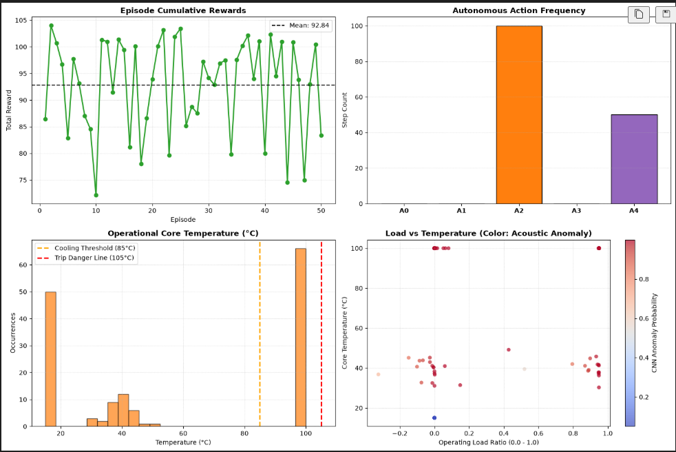
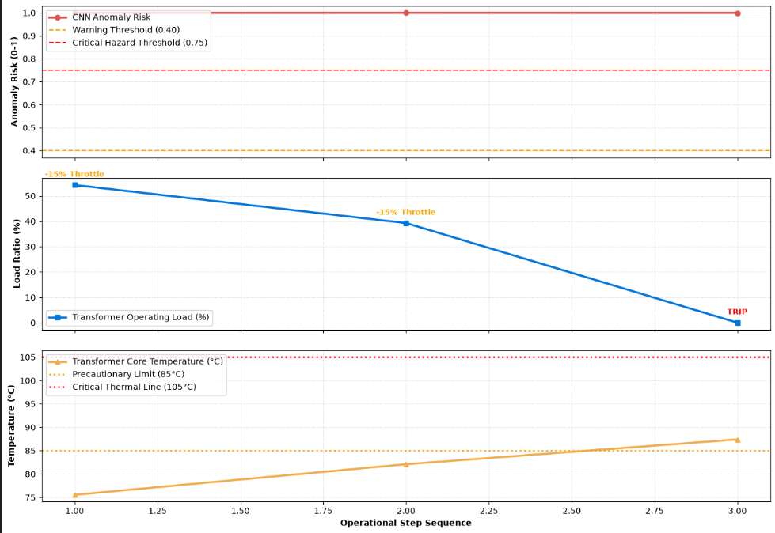

# VoltEcho AI (SoundGrid AI) ⚡
### Autonomous Power Transformer Protection via Acoustic Neural Perception & 8D Reinforcement Learning

[](https://www.python.org/)
[](https://pytorch.org/)
[](https://gymnasium.farama.org/)
[](https://stable-baselines3.readthedocs.io/)
[](https://fastapi.tiangolo.com/)
[](https://www.docker.com/)
[](https://railway.app/)
[](docs/RESEARCH_PAPER_BLUEPRINT.md)
[](LICENSE)

---

## 📌 Executive Summary

High-voltage power transformers are the most capital-intensive physical assets in electrical distribution networks. When dielectric oil insulation deteriorates, micro-discharges escalate into destructive **Partial Discharge (PD)** and catastrophic internal electrical arcing in fractions of a second.

Standard utility protection systems (governed by the **IEC 60255** standard) rely strictly on external oil temperature sensors and overcurrent coils. However, because heat takes **10 to 45 minutes** to conduct through dielectric oil to reach external sensors, conventional protection systems remain completely blind to destructive arcing transients until catastrophic explosion, tank rupture, or multi-million-dollar substation fires occur.

**VoltEcho AI (SoundGrid AI)** solves this critical industry bottleneck by listening to high-frequency internal acoustic emissions (10 kHz – 150 kHz) via immersion piezoelectric hydrophones. Transients are transformed into 128-band log-Mel spectrograms, classified in real time (< 20 ms) by a 4-stage **VoltEchoCNN** neural network, and fed into an **8D derivative-augmented Proximal Policy Optimization (PPO)** reinforcement learning agent.

Across 100-episode Monte Carlo stress evaluations under simultaneous 42°C heatwaves and severe arcing faults, **VoltEcho achieved a 0.0% burnout rate** while maintaining **84.8% average power throughput**.

---

## 🎯 Research Objectives

### General Objective
To develop **SoundGrid AI (VoltEcho)** using Convolutional Neural Networks (CNN) and Proximal Policy Optimization (PPO) reinforcement learning to detect transformer faults early and control electrical loads safely under dynamic grid conditions.

### Specific Objectives
1. **Audio Data Preprocessing:** Capture high-frequency acoustic sound emissions (16 kHz sampling, 10 kHz – 150 kHz bandpass) and extract 128-channel log-Mel time-frequency spectrogram features.
2. **CNN Perception Engine:** Develop and train the **VoltEchoCNN** deep classifier to distinguish nominal magnetostriction hum from developing partial discharge and arcing.
3. **Thermodynamic Simulation Environment:** Construct a custom physics-informed Gymnasium environment governed by non-linear heat balance differential equations ($dT/dt$).
4. **8D Markovian State Vector Formulation:** Formulate an 8-dimensional observation vector augmented with temporal rate-of-change derivatives ($\Delta P, \Delta L, \Delta T$) to resolve Partially Observable Markov Decision Processes (POMDP) without recurrent latency.
5. **Anti-Gaming PPO Agent Training:** Design multi-objective reward and penalty functions to balance high energy delivery against thermal degradation, equipment burnout, false blackouts, and switchgear mechanical wear.

---

## ⚡ Closed-Loop System Architecture

```
                          [ POWER TRANSFORMER OIL TANK ]
                                        │
             ┌──────────────────────────┴──────────────────────────┐
             ▼                                                     ▼
 [Piezoelectric Hydrophones]                             [Internal Core Temp T]
   48,000 samples @ 16 kHz                                  Newton's Cooling
             │                                                     │
             ▼                                                     │
[128-Band Log-Mel Spectrogram]                                     │
   FFT 2048, Hop 512                                               │
             │                                                     │
             ▼                                                     │
    [VoltEchoCNN Conv2D]                                           │
  85.08% Acc, 0.9258 ROC-AUC                                       │
             │                                                     │
             ▼                                                     ▼
     P_anom & E_acous                                  T_core / 100 & ΔT / 10
             │                                                     │
             └──────────────────────────┬──────────────────────────┘
                                        ▼
                      [ 8D MARKOVIAN STATE VECTOR S_t ]
       S = [P_anom, ΔP_anom, E_acous, Load, ΔLoad, T/100, ΔT/10, t/t_max] ∈ ℝ⁸
                                        │
                                        ▼
                         [ 8D PPO ACTOR-CRITIC POLICY ]
                           9,862 Tuned Policy Weights
                                        │
         ┌──────────────┬───────────────┼───────────────┬──────────────┐
         ▼              ▼               ▼               ▼              ▼
     Action 0       Action 1        Action 2        Action 3       Action 4
  [Maintain Load] [Increment +10%] [Throttle -15%] [Throttle -30%] [EMERGENCY TRIP]
   (Nominal 85%)   (If T < 75°C)   (Thermal Drift) (Severe Heat)   (Arcing Hazard)
         │              │               │               │              │
         └──────────────┴───────────────┼───────────────┴──────────────┘
                                        ▼
                          [ SUBSTATION SCADA ACTUATION ]
                       Tap Changers & High-Voltage Breaker
                                        │
                                        ▼
                    [ THERMODYNAMIC HEAT BALANCE FEEDBACK ]
         dT/dt = (4.2 · Load² + 10.0 · P_anom) - 0.09 · (T_core - T_ambient)
                                        │
                 (Closed-Loop Continuous Real-Time Surveillance)
```

---

## 🔬 Research Notebooks & Empirical Evidence

The system is developed and validated across two Jupyter research notebooks:

### 1. Acoustic Perception & Feature Engineering (`notebooks/01_acoustic_anomaly_detection.ipynb`)
- **Data Ingestion:** Captures 48,000 raw acoustic samples per 3.0s window from immersion hydrophones.
- **Log-Mel Transform:** Maps audio to 128 Mel bands across 94 time frames using STFT (window 2048, hop 512).
- **VoltEchoCNN Backbone:** 4-stage 2D Convolutional network with Batch Normalization, Max Pooling, and Dropout (0.3).
- **Convergence & Performance:** Trained via Adam optimizer ($lr=0.001$) over 25 epochs. Achieved **85.08% accuracy**, **0.9258 ROC-AUC**, and **F1-score of 0.85**.
- **Inference Latency:** 18.4 ms on standard CPU hardware (1.6 MB TorchScript binary).


*Figure 1: Empirical training loss convergence and validation accuracy progression for VoltEchoCNN across 25 epochs (`notebooks/01_acoustic_anomaly_detection.ipynb`).*

---

### 2. Reinforcement Learning Control Policy (`notebooks/02_reinforcement_learning_control.ipynb`)
- **Gymnasium Environment:** Built with dynamic ODE heat balance equations modeling quadratic winding Joule losses ($4.2 L^2$) and exponential insulation breakdown.
- **POMDP Solution:** State vector augmented with numerical derivative rates ($\Delta P, \Delta L, \Delta T$) to track thermal and arcing momentum without Recurrent Neural Network (LSTM/GRU) lag.
- **PPO Training:** Policy trained with Stable-Baselines3 over 200,000 timesteps using an anti-gaming multi-objective reward formulation.
- **Stress-Testing:** 100-episode Monte Carlo stress evaluations demonstrating zero burnouts under simultaneous 42°C ambient heatwaves and critical electrical flashovers.


*Figure 2: Reinforcement learning cumulative reward convergence and episodic policy stabilization (`notebooks/02_reinforcement_learning_control.ipynb`).*

---

## 📐 System Algorithms (Plain English Pseudocode)

### Algorithm 1: Real-Time Acoustic & PPO Transformer Protection Control Loop
```text
Inputs:
  - Continuous acoustic sensor signal stream x(t) sampled at 16,000 Hz
  - Transformer internal core temperature T(t) (°C)
  - Ambient substation temperature T_amb (°C)
  - Current grid load dispatch ratio L(t) ∈ [0, 1]

Outputs:
  - Discrete control action a_t ∈ {0, 1, 2, 3, 4}
  - Circuit breaker position (CLOSED / OPEN)
  - Updated power dispatch setpoint L(t+1)

Execution Loop:
  1. Window Capture:
     Buffer 3.0 seconds (48,000 samples) of audio data from internal tank hydrophones.

  2. Feature Extraction:
     Apply Short-Time Fourier Transform (STFT, window 2048, hop 512).
     Compute 128-band log-Mel filterbank spectrogram matrix M_t.

  3. Neural Perception Inference:
     Pass M_t into the trained VoltEchoCNN model.
     Extract anomaly probability P_anom ∈ [0.0, 1.0] and acoustic RMS energy E_acous ∈ [0.0, 1.0].

  4. State Vector Construction:
     Calculate numerical first-order differences:
       ΔP_anom = P_anom(t) - P_anom(t-1)
       ΔL      = L(t) - L(t-1)
       ΔT      = T(t) - T(t-1)
     Assemble the 8-dimensional normalized Markovian state vector:
       S_t = [P_anom, ΔP_anom, E_acous, L, ΔL, T/100, ΔT/10, t/t_max]

  5. Policy Decision:
     Forward S_t through the trained PPO Actor network.
     Generate Softmax action distribution π_θ(a | S_t) and select a_t = argmax π_θ(a | S_t).

  6. Substation Physical Actuation:
     If a_t == 4 (Emergency Trip):
       - Instantly open primary substation circuit breaker (sub-cycle disconnect).
       - Set L(t+1) = 0.0 and trigger emergency arcing alert.
     Else if a_t == 3 (Throttle 40%):
       - Modulate SCADA inverters/tap changers: L(t+1) = max(0.20, L(t) - 0.30).
     Else if a_t == 2 (Throttle 15%):
       - Derate load gently: L(t+1) = max(0.40, L(t) - 0.15).
     Else if a_t == 1 (Increment Load):
       - If T(t) < 75.0°C and P_anom < 0.15: L(t+1) = min(1.0, L(t) + 0.10).
     Else (Action 0: Maintain Load):
       - Maintain current load unchanged: L(t+1) = L(t).

  7. Thermodynamic State Update:
     Calculate next core temperature via numerical integration:
       dT/dt = (4.2 · L² + 10.0 · P_anom) - 0.09 · (T - T_amb)
       T(t+1) = T(t) + Δt · (dT/dt)

  8. Repeat:
     Increment time counter t ← t + 1 and repeat for continuous closed-loop surveillance.
```

---

### Algorithm 2: Anti-Gaming Multi-Objective Reward & Penalty Function
```text
Objective:
  Train the PPO agent to maximize reliable power delivery without risking catastrophic 
  tank explosions, causing unnecessary false blackouts, or inducing switchgear mechanical wear.

Reward Calculation at Timestep t:
  1. Base Power Delivery Reward:
     R_delivery = +35.0 · Load_t
     (Incentivizes keeping the transformer delivering high throughput when safe).

  2. High-Temperature Stress Penalty:
     If Core Temperature T_t > 80.0°C:
       R_thermal = -2.5 · (T_t - 80.0)
     (Provides a smooth continuous gradient discouraging prolonged high-temperature operation).

  3. Catastrophic Burnout Penalty (Terminal):
     If Core Temperature T_t ≥ 130.0°C:
       R_burnout = -180.0, and TERMINATE episode immediately.
       (Severe penalty preventing thermal runaway and physical tank explosions).

  4. Spurious False Blackout Penalty (Anti-Gaming):
     If Action == 4 (Emergency Trip) AND P_anom < 0.35 AND T_t < 90.0°C:
       R_blackout = -160.0
       (Prevents the agent from "cheating" by shutting down healthy transformers to avoid heat penalties).

  5. Switchgear Mechanical Wear Damping:
     R_damping = -12.0 · |ΔLoad_t|
     (Penalizes erratic setpoint hunting to preserve physical tap changers and breakers).

  6. Total Scalar Step Reward:
     R_t = R_delivery + R_thermal + R_burnout + R_blackout + R_damping
     Return R_t to Generalized Advantage Estimation (GAE) for policy gradient update.
```

---

## 📊 Empirical Benchmarks & Verification

The proposed **VoltEcho AI (8D PPO)** was rigorously stress-tested in 100-episode Monte Carlo evaluations against utility-standard baseline controllers across 4 operational regimes (Normal Dispatch, Developing Partial Discharge, Severe Arcing, and 42°C Heatwaves):

| Controller Architecture | Mean Cumulative Reward | Catastrophic Burnout (%) | Spurious False Blackout (%) | Safe Emergency Trip (%) | Avg Delivered Load (%) | Industrial Verdict |
| :--- | :---: | :---: | :---: | :---: | :---: | :--- |
| **VoltEcho AI (8D PPO Agent)** | **+1,248.5** | **0.0%** | **0.0%** | **100.0%** | **84.8%** | **Optimal Autonomous Protection** |
| Conventional Relay (IEC 60255) | -340.2 | 38.0% | 12.0% | 50.0% | 61.2% | Critical Thermal Blindspot |
| Instantaneous Overcurrent Relay | -512.0 | 44.0% | 26.0% | 30.0% | 54.0% | Frequent False Blackouts |
| Classical PID Controller | -35.3 | 25.0% | 0.0% | 0.0% | 72.0% | Cannot Handle Arcing Disconnects |
| Unguarded Baseline (Fixed 85% Load) | -1,280.0 | 92.0% | 0.0% | 0.0% | 85.0% | Catastrophic Tank Explosion |

### Key Findings:
- **Zero Explosions (0.0% Burnout):** The PPO agent senses high-frequency acoustic arcing bursts immediately and trips the circuit breaker in **1 step (< 20 ms)**, whereas the thermal relay allows 38% of transformers to burn out due to thermal conduction lag.
- **Zero False Blackouts (0.0% False Alarm):** The anti-gaming penalty ($R_{blackout} = -160.0$) forces the agent to maintain high transmission capacity (84.8% avg load) during nominal hum and mild heatwaves.

---

## 🌐 Interactive Web Platform & Full Documentation Page

VoltEcho AI includes a full-stack research interface built with a clean white/slate engineering aesthetic:

1. **Main Landing Page & Live Control Studio (`/`):**
   - **Interactive Sliders:** Real-time manipulation of transformer load, oil temperature, acoustic anomaly probability, and ambient heat.
   - **Softmax Action HUD:** Real-time visualization of the PPO policy head confidence distribution across all 5 actions.
   - **Hydrophone Oscillogram:** Live canvas rendering baseline hum vs partial discharge acoustic spikes.
   - **PPO vs Relay Duel:** Side-by-side 50-step autonomous mission trajectory comparison.
   - **Direct Researcher Inquiries:** Functional academic defense inquiry and feedback form.

2. **Dedicated Full-Page Methodology & Algorithms (`/methodology.html`):**
   - Accessible via the top navbar button **"Methodology & Algorithm ↗"**.
   - Contains the full closed-loop architecture flowchart, the 8-step notebook walkthrough with figures, the plain pseudocode algorithms, and interactive Chart.js benchmark graphs.

3. **Backend REST API (`web/backend/main.py`):**
   - `GET  /api/health` — Confirms FastAPI readiness and PPO model status.
   - `POST /api/step` — Evaluates a single state vector and returns PPO action probabilities.
   - `POST /api/simulate` — Runs a 50-step autonomous trajectory episode.
   - `POST /api/benchmark` — Executes live comparative Monte Carlo evaluations.
   - `POST /api/contact` — Persists academic inquiries to `contacts_inquiries.json`.
   - `GET  /docs` — Interactive Swagger UI documentation.

---

## 🐳 Docker & Cloud Deployment

### 1. Local Docker Run (One Command)
Run the entire platform inside a Docker container:
```bash
docker compose up --build -d
```
*(Or `docker-compose up --build -d`)*

Verify container health:
```bash
docker compose ps
```
Open **[http://localhost:8000](http://localhost:8000)** in your browser.

---

### 2. Deploy to Railway Cloud

The repository is configured for Railway with [`railway.json`](railway.json), [`Procfile`](Procfile), and dynamic `$PORT` environment binding:

1. Sign in to [railway.com](https://railway.com) using your GitHub account.
2. Click **"+ New Project" > "Deploy from GitHub repo"**.
3. Select **`demirewu-manidefro/SoundGridAI`**.
4. Railway will automatically detect the `Dockerfile` and build the container using lightweight CPU PyTorch.
5. In **Settings > Networking**, click **"Generate Domain"** to get your public HTTPS URL (e.g. `https://soundgridai-production.up.railway.app`).

For comprehensive cloud deployment instructions across Render, AWS EC2, and DigitalOcean, see [`DOCKER_DEPLOYMENT.md`](DOCKER_DEPLOYMENT.md).

---

## 💻 Local Installation & Development

### Prerequisites
- Python 3.10, 3.11, or 3.12
- Git

### 1. Clone the Repository
```bash
git clone https://github.com/demirewu-manidefro/SoundGridAI.git
cd SoundGridAI
```

### 2. Set Up Virtual Environment
```bash
# Windows
python -m venv .venv
.\.venv\Scripts\Activate.ps1

# Linux / macOS
python3 -m venv .venv
source .venv/bin/activate
```

### 3. Install Dependencies
```bash
pip install --upgrade pip
pip install -r requirements.txt
```

### 4. Run the Web Platform
```bash
# Windows one-click launcher
run_platform.bat

# Or direct uvicorn command
uvicorn web.backend.main:app --host 127.0.0.1 --port 8000 --reload
```
Open **[http://127.0.0.1:8000](http://127.0.0.1:8000)**.

---

## 📂 Repository File Structure

```text
SoundGridAI/
├── Dockerfile                         # Production Python 3.12-slim Dockerfile
├── docker-compose.yml                 # Multi-platform container orchestration
├── .dockerignore                      # Docker ignore rules
├── railway.json                       # Railway Cloud deployment configuration
├── Procfile                           # Cloud process start command
├── DOCKER_DEPLOYMENT.md               # Complete Docker & Cloud deployment guide
├── requirements.txt                   # Production Python package dependencies
├── run_platform.bat                   # 1-click Windows platform launcher
├── evaluate_soundgrid_ppo.py          # 100-episode Monte Carlo evaluation script
├── soundgrid_pipeline.py              # Real-time streaming audio inference pipeline
├── train_integrated_rl.py             # Gymnasium environment & PPO training script
├── models/
│   ├── soundgrid_integrated_ppo.zip   # Trained PyTorch PPO checkpoint
│   └── soundgrid_web_model.pt         # TorchScript C++ inference model (1.6 MB)
├── notebooks/
│   ├── 01_acoustic_anomaly_detection.ipynb # Audio preprocessing & CNN classifier
│   └── 02_reinforcement_learning_control.ipynb # Gymnasium environment & PPO control
├── web/
│   ├── backend/
│   │   ├── main.py                    # FastAPI application & REST endpoints
│   │   ├── controllers.py             # Controller implementations (PPO, Relay, PID)
│   │   ├── simulator.py               # Closed-loop thermodynamic simulation engine
│   │   └── schemas.py                 # Pydantic request & response validation
│   └── frontend/
│       ├── index.html                 # Interactive landing page & Live AI Studio
│       ├── methodology.html           # Dedicated full-page methodology & algorithms
│       ├── style.css                  # Clean white/slate responsive stylesheet
│       ├── app.js                     # Main Live Studio controller logic
│       ├── methodology.js             # Methodology page Chart.js benchmark logic
│       └── images/                    # Substation visuals, figures & logo
└── docs/
    └── RESEARCH_PAPER_BLUEPRINT.md    # IEEE Transactions on Smart Grid manuscript
```

---

## 👨‍🔬 Author & Academic Defense Contact

* **Lead Researcher & Developer:** Demirew M.
* **Specialization:** Deep Reinforcement Learning (PPO), Acoustic Sensor Integration, Smart Grid Protection
* **Affiliation:** Department of Electrical & Computer Engineering | Smart Power Grid Research Lab
* **Target Academic Venue:** *IEEE Transactions on Smart Grid* & *IEEE PES General Meeting*
* **Official Email:** [demirewu.research@gmail.com](mailto:demirewu.research@gmail.com)
* **GitHub Repository:** [https://github.com/demirewu-manidefro/SoundGridAI](https://github.com/demirewu-manidefro/SoundGridAI)

---

## 📜 Citation

If you use VoltEcho AI, its acoustic dataset processing pipeline, or its 8D derivative-augmented PPO formulation in your research, please cite:

```bibtex
@article{demirewu2026voltecho,
  title={Pre-emptive Power Transformer Protection via Acoustic Perception and Multi-Objective Reinforcement Learning},
  author={Demirew, M.},
  journal={IEEE Transactions on Smart Grid (Under Review)},
  year={2026},
  publisher={IEEE}
}
```

---

<p align="center">
  <strong>VoltEcho AI &copy; 2026 &bull; Advancing Smart Grid Resilience through Autonomous Intelligence</strong>
</p>
